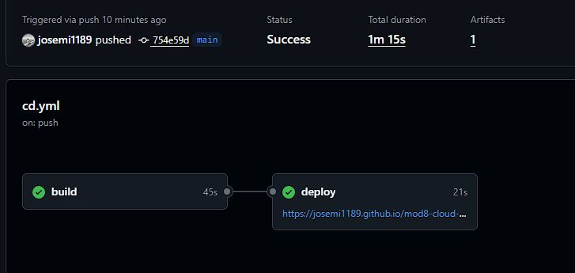

# Módulo 8 - Cloud

## Enlaces

[Repositorio GitHub](https://github.com/josemi1189/mod8-cloud-github-pages-auto)

[GitHub Pages](https://josemi1189.github.io/mod8-cloud-github-pages-auto/)

## Desplegar en Github Pages de forma automática con GitHub Actions.

1. Una vez creado nuestro repositorio en GitHub y conectado con nuestro proyecto en local debemos generar el archivo .yml que deberá estar en la raíz del proyecto, dentro de las carpetas `.github/workflows`.
2. Generamos el archivo de configuración de **GitHub Actions** según sea necesario.

3. Completamos configuración del archivo **.yml** añadiendo el uso de la clave privada, email y nombre de usuario y url sobre la cual se va a hacer deploy para dar permisos de escritura en nuestro repositorio de **GitHub**.

   ```yml
   name: CD Github Pages
   on:
     push:
       branches: main

   permissions:
     contents: read
     pages: write
     id-token: write

   # Si se hacen dos push seguidos y aun no ha terminado el primer despliegue, lo cancela para que se ejecute el segundo
   concurrency:
     group: "pages"
     cancel-in-progress: true

   jobs:
     build:
       runs-on: ubuntu-latest
       steps:
         - name: Checkout repository
           uses: actions/checkout@v7

         - name: Install and configure pnpm
           uses: pnpm/action-setup@v4
           with:
             version: 12.9.1

         - name: Config Node.js
           uses: actions/setup-node@v7
           with:
             node-version: 20
             cache: "pnpm"

         - name: Install dependencies
           run: pnpm install --frozen-lockfile

         - name: Build
           run: pnpm run build

         - name: Upload static files as artifact
           uses: actions/upload-pages-artifact@v5
           with:
             path: "./dist"

     deploy:
       environment:
         name: github-pages
         url: ${{ steps.deployment.outputs.page_url }}
       runs-on: ubuntu-latest
       needs: build
       steps:
         - name: Desplegar a GitHub Pages
           id: deployment
           uses: actions/deploy-pages@v5
   ```

4. Una vez subidos los cambios al repositorio se deben ejecutar las **GitHub Actions** de forma automática y al finalizar mostrará la url generada de despliegue en **GitHub Pages**.

   
